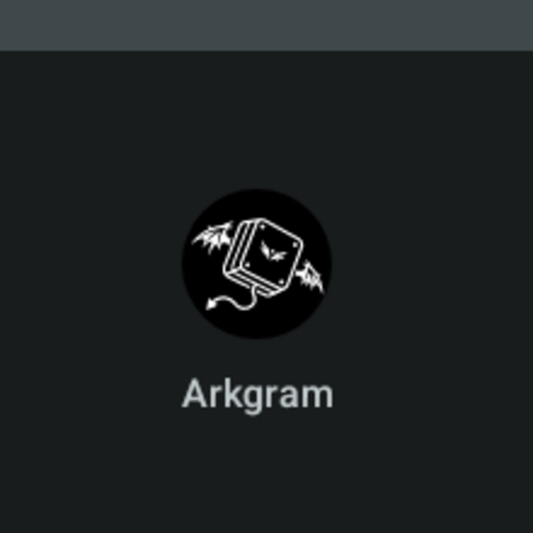
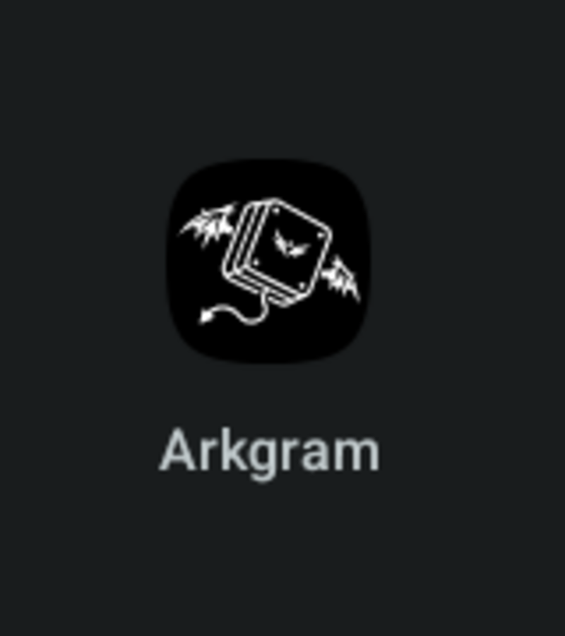
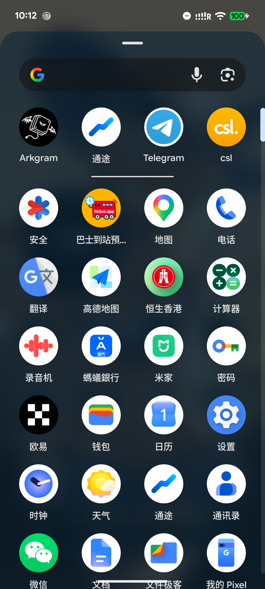
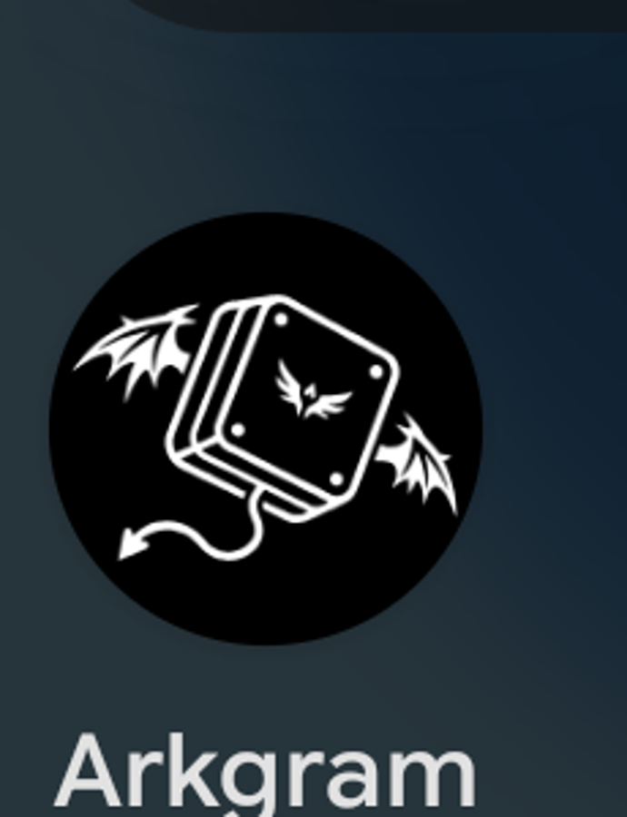

# Arkgram 图标矢量化与 Android 资产

输入：`/home/skadi/下载/图标.jpeg`（2048×2048 JPEG，无透明通道）

本目录同时保留两类结果，避免把 Google Play 商店图标与 Android 自适应启动器图标混用。

## 图像处理

`vectorize_icon.py` 使用 Python + OpenCV + Potrace 完成：

1. Pillow 读取并转灰度。
2. OpenCV 高斯平滑（`sigma=1.5`）去除 JPEG 振铃与边缘压缩噪点。
3. Otsu 二值化（本次阈值 `126/255`）。
4. 提取最大暗色连通域并填充内部，得到精确黑色圆盘掩膜。
5. 只在圆盘内部保留面积不小于 20 px 的亮色连通域，作为白色线条。
6. 分别对黑色圆盘和白色线条运行 Potrace，生成闭合贝塞尔路径。
7. 合成“透明外部 → 黑色圆盘 → 白色线条”的 SVG，不包含背景矩形。
8. 从 SVG 渲染 PNG，并与二值掩膜计算 IoU 和边界偏差。

核心验证结果：

- 黑色圆盘 IoU：`0.999695`
- 白色线条 IoU：`0.991679`
- 白色轮廓平均偏差：`0.051 px`
- 四角 alpha：`0`
- 圆盘边缘外扩 2 px 之外的 alpha 非零像素：`0`

## 输出文件

### 原始透明背景版本

- `arkgram_icon.svg`：`viewBox="0 0 2048 2048"`，外部全透明，保留完整黑色圆盘。
- `arkgram_icon_2048.png`：2048×2048 RGBA PNG。
- `arkgram_icon_preview_checkerboard.png`：透明区域棋盘格预览。
- `arkgram_icon_black_mask.png`：黑色圆盘二值掩膜。
- `vectorization_report.json`：矢量化指标。

### Google Play 商店图标

- `arkgram_play_store_512.png`
- 512×512，RGBA 32-bit PNG，所有像素 alpha=`255`
- 满幅不透明黑底，无预圆角、无外阴影
- 文件约 30 KB，低于 1024 KB
- 已用于项目当前默认图标的 Play 商店素材：
  - `TMessagesProj/src/main/ic_launcher_nagram_blue-playstore.png`
  - `TMessagesProj/src/main/ic_launcher_nagram_round_blue-playstore.png`

说明：Play 会自行添加圆角和阴影，因此商店素材不能预 baked 透明圆盘外形。这里的满幅黑色由平台遮罩形成最终外观。

### Android 自适应图标

- `arkgram_icon_foreground.xml`：108×108dp VectorDrawable，仅白色线条。
- `arkgram_icon_monochrome.xml`：同一 alpha 轮廓，供 Android 13+ 主题图标系统着色。
- `arkgram_adaptive_foreground.svg`：相同几何的 SVG，用于离线检查。
- `arkgram_adaptive_foreground_1080.png`：1080×1080 透明前景验证图。
- `arkgram_adaptive_preview.png`：完整图层、圆形遮罩、圆角方形遮罩预览。
- `android_icon_report.json`：安全区与商店图标规范验证结果。

自适应图标采用：

- 背景层：纯黑 `#000000`
- 前景层：仅白色线条，不再重复黑色圆盘
- 视口：`108×108 dp`
- 官方安全区：中央 `66×66 dp`
- 本实现可见边界：最大边长 `64 dp`，相对安全区留 1 dp/边抗锯齿余量
- 实际渲染边界：`x=22–86 dp`、`y=31.8–76.2 dp`
- 前景四角完全透明，系统负责裁切圆形/圆角方形及主题着色

这里的 `66×66 dp` 指中央安全**正方形**，不是必须在其中再内切一个直径 66 dp 的圆。白色线条 bbox 为 `64×44.4 dp`，完全位于该正方形内；最远点到中心约 `35.23 dp`，虽然大于内切圆半径 `33 dp`，但仍在官方安全正方形内，因此不会被标准自适应遮罩裁掉。它比安全区略小，是为了保留抗锯齿边缘并避免不同 OEM 遮罩造成视觉裁切。

## 项目接入

当前自适应图标 XML 继续引用同名资源：

`TMessagesProj/src/main/res/mipmap-anydpi-v26/ic_launcher_nagram_blue.xml`

```xml
<adaptive-icon xmlns:android="http://schemas.android.com/apk/res/android">
    <background android:drawable="@color/arkgram_icon_background" />
    <foreground android:drawable="@drawable/arkgram_icon_foreground" />
    <monochrome android:drawable="@drawable/arkgram_icon_monochrome" />
</adaptive-icon>
```

原先 `drawable-nodpi` 中的两张 PNG 已由同名 VectorDrawable 替代，避免位图在 108dp 图层里的分辨率与安全区漂移。

## 复现

```bash
cd /home/skadi/文档/Project/Arkgram
python3 icon_conversion/vectorize_icon.py \
  '/home/skadi/下载/图标.jpeg' \
  icon_conversion \
  --blur-sigma 1.5 \
  --render-size 2048

python3 icon_conversion/prepare_android_icons.py \
  '/home/skadi/下载/图标.jpeg' \
  icon_conversion \
  --full-svg icon_conversion/arkgram_icon.svg
```

依赖：Python 3、Pillow、OpenCV、NumPy、Potrace、librsvg。

## 构建与设备验证

已在当前工程完成 Debug APK 构建：

```bash
KEYSTORE_PASS='<keystore-password>' \
ALIAS_NAME='<key-alias>' \
ALIAS_PASS='<key-password>' \
NATIVE_TARGET=SKIP \
./gradlew :TMessagesProj:assembleDebug --stacktrace
```

构建结果：`BUILD SUCCESSFUL`。

```text
APK: TMessagesProj/build/outputs/apk/debug/Arkgram-v13.0.2(1261)-debug.apk
SHA-256: 9b56b4331e675721e9de170977a58eb5c86344eff4b39432414c900b7e505b48
```

已在 Waydroid x86_64（Android 13）和 Pixel 6（Android 17）上完成验证。Pixel 6 使用 debug 签名安装；由于原安装签名不同，安装前执行了完整卸载。从启动器图标直接启动成功：

```bash
adb -s 192.168.240.112:5555 shell am start -W -n \
  io.skadi.arkgram/org.telegram.messenger.DefaultIcon
```

启动器实际渲染验证（白色线条完整，无裁切）：

圆形自适应遮罩：



临时切换 squircle 遮罩：



随后已恢复设备原有圆形遮罩。完整截图见 `device_validation/`。Pixel 6 应用抽屉和图标放大验证结果：





设置页的“应用图标 → 默认”预览也已在 Pixel 6 上验证，黑色背景和白色线条均正常显示。Android 13+ 的 `<monochrome>` 资源已完成静态接线和 APK 打包检查。

## 官方规范核对

- [自适应图标设计](https://developer.android.com/develop/ui/compose/system/icon_design_adaptive?hl=zh-cn)：所有图层为 `108×108 dp`，中央 `66×66 dp` 为不被 OEM 遮罩裁切的区域；外围每边 `18 dp` 用于遮罩、视差等视觉效果。前景与背景分层，Android 13+ 可提供 monochrome 层。
- [Google Play 图标规范](https://developer.android.com/distribute/google-play/resources/icon-design-specifications?hl=zh-cn)：最终尺寸 `512×512 px`、上限 `1024 KB`；不要保留透明部分，也不要预烘焙圆角和阴影，因为 Play 会动态应用约 20% 的圆角遮罩和阴影。

因此，原始“透明背景上的黑色圆盘”位图不能同时直接充当 Play 商店图标和自适应启动器图标。当前实现按用途拆分后符合上述规则。
